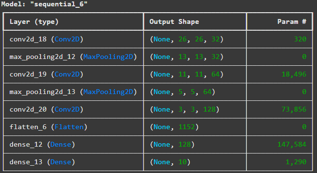
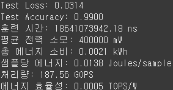
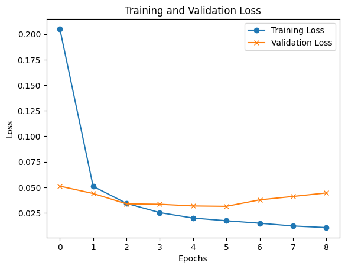
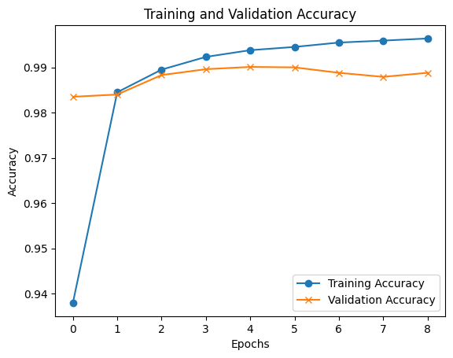
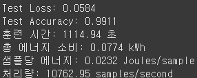
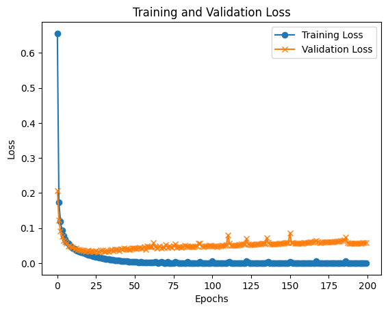
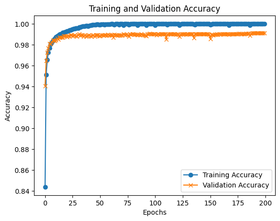

# CNN 학습으로 보는 하드웨어(GPU vs TPU) 연산 효율 비교

같은 MNIST CNN 학습을 **A100 GPU**와 **TPU**에서 각각 돌려 보고, 학습 시간·에너지 소비·처리량을 계산해 비교한 실험입니다.

- 언어/프레임워크: Python, TensorFlow(Keras), Matplotlib
- 실행 환경: Google Colab (A100 GPU / TPU 런타임)
- Claude AI는 github 정리에만 사용, 코드 작성에는 미사용함.

```
src/
  a100_gpu_version.py   # A100 GPU 버전 (Conv 3층, EarlyStopping, 최대 20 epochs)
  tpu_version.py        # TPU 버전 (Conv 2층, TPUStrategy, 200 epochs)
results/                # 모델 구조, 결과 출력, 손실·정확도 그래프
```

## A100 GPU 버전

`src/a100_gpu_version.py`

- 구조: Conv(32) → MaxPool → Conv(64) → MaxPool → Conv(128) → Flatten → Dense(128) → Dense(10)
- Adam(lr = 1e-3), batch 128, EarlyStopping(patience 3)
- 평균 전력(400W 가정)과 학습 시간으로 총 에너지·샘플당 에너지를 계산하고, 층별 FLOPs로 처리량(GOPS)·TOPS/W를 추정

| 모델 구조 | 결과 출력 |
|---|---|
|  |  |

| 손실 | 정확도 |
|---|---|
|  |  |

**결과:** 테스트 정확도 0.9900, 총 에너지 약 0.0021 kWh, 처리량 약 187.56 GOPS (EarlyStopping으로 9 epoch에서 종료)

## TPU 버전

`src/tpu_version.py`

- 구조: Conv(32) → MaxPool → Conv(64) → MaxPool → Flatten → Dense(128) → Dense(10)
- Adam(lr = 1e-4), batch 128, `steps_per_execution=32`, 200 epochs
- 평균 전력(TPU v3-8, 250W 가정)으로 에너지와 초당 처리 샘플 수 계산

| 결과 출력 | 손실 | 정확도 |
|---|---|---|
|  |  |  |

**결과:** 테스트 정확도 0.9911, 학습 시간 약 1114.94초, 총 에너지 약 0.0774 kWh, 처리량 약 10762.95 samples/s

## 참고

- 전력 값은 실제 측정값이 아니라 **하드웨어 평균 전력을 가정한 상수**입니다. 따라서 에너지 수치는 추정치입니다.
- 두 버전은 모델 구조·학습률·epoch 수가 서로 달라서, 결과는 같은 조건의 1:1 비교라기보다 각 환경에서의 실행 기록에 가깝습니다.

## 실행 방법

```bash
pip install -r requirements.txt
python src/a100_gpu_version.py
```

TPU 버전은 Google Colab의 TPU 런타임에서 실행해야 합니다.
